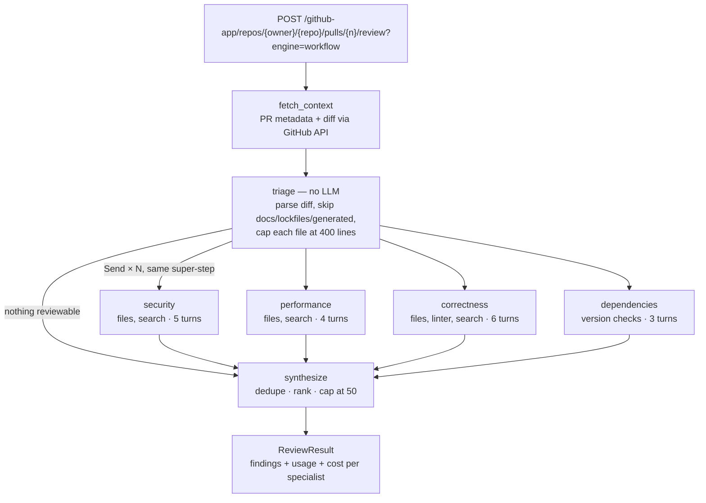

# codereview-agent

A GitHub App that reviews pull requests with AI agents that **investigate the code instead of skimming the diff**. A triage step that makes no model calls trims the diff. Specialist agents (security, performance, correctness, dependencies) then run in parallel, each with its own tools, context and budget. A deterministic synthesis step merges their findings into one ranked, typed review that reports exactly what it cost.

> **Status:** in progress, week 3 of 4. The review engine works end to end against real PRs. Next: asynchronous reviews (SQS + a worker), LangGraph checkpoints in Postgres for crash-resume, an MCP server, and deployment.
>
> Case study with design decisions and measurements: **[harishraju.tech/work/codereview-agent](https://harishraju.tech/work/codereview-agent/)**

---

## How a review runs



Each specialist runs as its own compiled LangGraph subgraph with its own conversation. Only its findings and token counts come back to the parent, which keeps context isolated by design. Every specialist sees the full file inventory but only its own files' diffs. If one specialist times out or hits an API error, the others still return, and the review is marked partial with `incomplete_specialists`.

### Agent tools

| Tool | What it does |
|---|---|
| `get_file_content` | Reads a file at the PR's head commit (the ref is fixed by the server, never chosen by the model) |
| `search_codebase` | GitHub code search within the repository |
| `check_dependency_versions` | Finds Python, npm and NuGet manifests, parses pinned versions, and checks the registries for newer ones |
| `run_linter` | Runs `ruff` (Python), `oxlint` (JS/TS) or `dotnet format` (C#) on a changed file |
| `submit_review` | Ends the run. Output is validated against the `ReviewFinding` schema, and errors go back to the model to fix |

Tool calls are checked against the schema the model was shown and against that agent's allowed tools. Invented arguments come back as an error the model can correct, instead of being silently ignored.

---

## Three engines, one API

`?engine=` selects how the review runs, so the approaches can be compared against the same server and the same PR:

| Engine | What it is | Why it exists |
|---|---|---|
| `loop` (default) | A hand-written tool-use loop on the Anthropic SDK | Understand the mechanics before adopting a framework |
| `graph` | The same loop ported to LangGraph, kept equivalent by parity tests | A like-for-like comparison of hand-rolled vs framework |
| `workflow` | Triage → parallel specialists → synthesis | What a graph framework is actually good at |

In every engine, the last allowed iteration forces `submit_review`, so a run that uses its whole budget still returns a review instead of an error.

---

## Measured results

Real runs with `claude-haiku-4-5`. Full logs and analysis are in [`docs/week-3/`](docs/week-3/).

**Triage on real PRs** (no model calls):

| PR | Files | Reviewable | Diff in → out |
|---|---|---|---|
| #1 (large feature branch) | 26 | 13 | 397 KB → 54 KB (−86%) |
| #2 (README only) | 1 | 0 | 339 B → 0. Returns in 2.2 s with zero model calls |

**Single loop vs multi-agent workflow, same PR:**

| PR #1 | `loop` | `workflow` |
|---|---|---|
| Findings | 3 (2 about docs) | 10 (all about code) |
| Model calls | 3 | 15 |
| Input / output tokens | 342k / 1.8k | 399k / 3.5k |
| Cost | $0.351 | $0.417 |
| Wall-clock | 27.7 s | 26.9 s |

The workflow costs slightly more, but it reviews the code rather than the docs, with five times as many model calls in the same time. Most of its input tokens are re-sent conversation history, which makes prompt caching the next cost experiment. Of the 10 findings, roughly 4–5 were useful, 3 theoretical and 2 false positives caused by the linter tool's isolated config. A seeded-bug PR is planned to turn "useful" into a measured recall number.

---

## Design decisions

- **GitHub App, not OAuth App.** Installed per repository, with read-only permissions (Contents, Pull requests, Metadata). The App's private key signs a JWT that is exchanged for short-lived installation tokens, cached server-side. The browser only ever holds a signed, opaque installation ID.
- **Split by concern, not by file.** About four specialist runs per review regardless of PR size, and reasoning across files stays inside each concern.
- **Failure isolation inside the node.** I tested LangGraph's `error_handler`, and in v1.2.12 it doesn't fire for tasks started with `Send`. So each specialist wraps its run in `asyncio.timeout` plus a narrow `try/except`. There's deliberately no catch-all, so real bugs still fail loudly.
- **Retries in exactly one layer.** The Anthropic SDK retries model calls, and `call_with_retry` retries GitHub calls. There's no LangGraph `retry_policy`, which would re-run and re-pay for an entire specialist.
- **Typed boundaries.** Every GitHub and Anthropic response is parsed into a Pydantic model before anything uses it.
- **Cost on every run, including failures.** Usage is attached to the error responses too, because a failed review has still been billed.

The reasoning behind each decision, including the alternatives considered, is in [`docs/architecture-patterns.md`](docs/architecture-patterns.md) and the dated notes for each day under [`docs/`](docs/).

---

## API

| Method | Route | What it does |
|---|---|---|
| `GET` | `/health` | Liveness check |
| `GET` | `/github-app/install` | Redirects to the App's install page |
| `GET` | `/github-app/callback` | Setup URL: stores the signed installation cookie |
| `GET` | `/github-app/installations/current` | The installation and the repositories it can access |
| `GET` | `/github-app/repos/{owner}/{repo}/pulls` | Lists open PRs |
| `GET` | `/github-app/repos/{owner}/{repo}/pulls/{number}/diff` | Raw PR diff |
| `POST` | `/github-app/repos/{owner}/{repo}/pulls/{number}/review?engine=loop\|graph\|workflow` | Runs a review and returns findings, token usage and cost |

The review endpoint is synchronous for now. Moving it to `202 Accepted` + an SQS worker + polling is the next step.

---

## Running locally

**Prerequisites:** Python 3.12, [uv](https://docs.astral.sh/uv/), an Anthropic API key. The `dotnet` SDK is only needed to lint C# files.

1. **Register a GitHub App** (Settings → Developer settings → GitHub Apps):
   - Permissions, all **read-only**: Contents, Pull requests, Metadata
   - Setup URL: `http://localhost:8000/github-app/callback`
   - Webhook: off
   - Generate a private key and save it as `github-app-private-key.pem` in the repo root. It's gitignored.
2. **Configure:**
   ```bash
   cp .env.example .env
   ```
   Fill in `GITHUB_APP_ID`, `GITHUB_APP_SLUG`, `SESSION_SECRET_KEY` (any long random string), `ANTHROPIC_API_KEY`, and optionally `ANTHROPIC_MODEL` (the measurements above used `claude-haiku-4-5`).
3. **Run:**
   ```bash
   uv sync
   uv run uvicorn src.main:app --reload
   ```
   Or use Docker: `docker compose up --build`. The `.pem` is mounted read-only and never baked into the image.
4. **Install and review:** open `http://localhost:8000/github-app/install`, install the App on a repository, then:
   ```bash
   curl -X POST -b cookies.txt \
     "http://localhost:8000/github-app/repos/<owner>/<repo>/pulls/<n>/review?engine=workflow"
   ```
   The installation cookie is set in your browser by the callback, so it's easiest to call the endpoint from the browser session or copy the cookie into `cookies.txt`.

## Tests

```bash
uv run pytest        # 133 tests, no network: GitHub via respx, the model via fakes
uv run ruff check .
```

The suite never calls the real GitHub or Anthropic APIs. Paid end-to-end runs are done by hand and recorded in the docs, because two bugs so far only appeared against the live APIs. One was a model ID with a date suffix that broke an exact-match price lookup.

---

## Project layout

```
src/
  routers/        HTTP only: parse, call a service, shape the response
  services/       business logic, no FastAPI imports
    review_agent.py       the hand-written tool-use loop (engine: loop)
    review_tools.py       tool definitions, argument checks, execution
    review_graph/         LangGraph engines: loop_graph, workflow_graph,
                          triage, specialists, synthesize
    linters/              ruff / oxlint / dotnet format dispatch
    model_pricing.py      token → cost, including dated model IDs
  schemas/        Pydantic models for every boundary
  dependencies/   FastAPI Depends(): shared httpx/Anthropic clients, auth
docs/             plans, daily notes and retrospectives per week
tests/
```

## Roadmap

- [x] GitHub App auth, PR and diff fetching, retry with backoff
- [x] Tool-use agent loop with five tools and cost tracking
- [x] LangGraph port with parity tests, plus the multi-agent workflow
- [ ] Seeded-bug eval: recall, duplicate rate and cost across engines
- [ ] Postgres-backed review records and LangGraph checkpoints (resume after a crash)
- [ ] SQS queue + worker; `202 Accepted` + polling
- [ ] MCP server exposing the review tools
- [ ] Prompt caching, with cache-aware cost accounting
- [ ] Deploy to `codereview.harishraju.tech`
