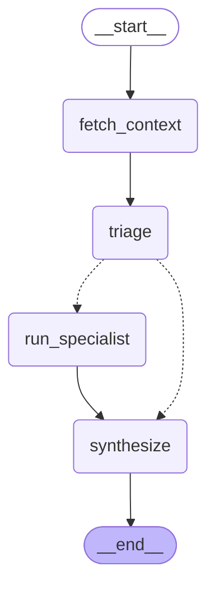

# Day 2 — From a Loop to a Workflow: Triage, Parallel Specialists, Synthesis

Plan: `docs/week-3/week-3-day-2-plan.md`. Five commits, one idea each, every one passing `pytest` and `ruff` on its own (checked by checking out each commit and running both):

| Commit | What | Tests at that commit |
|---|---|---|
| `5376916` | No-LLM triage: diff → per-file `FileChange` + inventory | 109 |
| `0383212` | Tool guards: reject unknown/missing arguments and tools outside an agent's subset | 113 |
| `96983c6` | `build_agent_graph(config)`: the Day 1 port becomes one config of a factory | 113 |
| `6091cf6` | Test fix: register the diff mock before the metadata mock | 113 |
| `703f55e` | The `workflow` engine: routing, parallel specialists, synthesis, partial reviews | 133 |

**No paid Claude calls were made today** (per your instruction). Everything below was verified with fakes, with free GitHub API calls, or with one real end-to-end run that by design makes no model calls. The paid manual checks are listed at the end, awaiting approval.

---

## What happened

### Triage measured against the real PRs (free: GitHub API only)

Both real PRs' diffs were fetched from GitHub and run through `triage_diff`:

| PR | Files | Reviewable | Diff size before → after | Notes |
|---|---|---|---|---|
| #1 (large) | 26 | 13 | 397 KB → **54 KB (−86%)** | 13 Markdown docs skipped; `review_agent.py` (513 lines) trimmed and marked truncated |
| #2 (README) | 1 | 0 | 339 B → **0** | Documentation only → zero specialists |

Day 1's real run re-sent the whole 397 KB on every iteration (~114k input tokens per call). On this PR each code specialist's *first* message now carries ~54 KB of diff plus a ~2 KB inventory. That's the structural fix for the cost problem Day 1 measured, ahead of any paid run confirming it.

### The README-only PR, end to end through the real server (free)

`POST …/pulls/2/review?engine=workflow` against the running app: `200` in 2.2 s with `findings: []` and usage of `0/0` tokens, `$0.00`. The server log shows the GitHub token, metadata, and diff calls, then `triage — 1 file(s) changed, 0 reviewable`, then the result. **Zero requests to `api.anthropic.com`.** The Week 2 loop spent $0.02 and 5 iterations to reach the same correct answer for this PR on Day 1.

### `error_handler` evaluated: it doesn't work for `Send` tasks (in 1.2.12)

The plan asked to evaluate `add_node(..., error_handler=...)` against an `asyncio.timeout` inside the node. Tested in throwaway scripts, with no API calls:

| Node reached by | Failure | `error_handler` fired? |
|---|---|---|
| a normal edge | plain `RuntimeError` | ✅ yes, its `Command(update=...)` became state |
| a normal edge | the node's own `timeout=` (`NodeTimeoutError`) | ✅ yes |
| `Send` (fan-out) | plain `RuntimeError` | ❌ no, the whole run failed |
| `Send` (fan-out) | `timeout=` / in-node `TimeoutError` | ❌ no, the whole run failed |

Specialists are started by `Send`, so the framework option can't isolate their failures in this version. **Decision:** `asyncio.timeout` + `try/except` inside `run_specialist` (catchable, and it turns a failure into a `timed_out` / `failed` result entry), with the node-level `timeout=` kept only as a backstop 30 s higher. Worth re-testing on a future LangGraph upgrade, since it may be a gap rather than a design choice.

### Subgraph checkpoint propagation: confirmed (an input for Day 4)

The workflow was compiled with an `InMemorySaver` and run once with fakes. Checkpoints were written under five namespaces: the parent (`""`) and one per specialist (`run_specialist:<task id>`), 22 checkpoints in total. **Each specialist's own steps are checkpointed** even though the subgraph is invoked from inside a wrapper node with its own config. So Day 4's crash-resume can continue *inside* a half-finished specialist, not just re-run whole specialists.

### Found by writing tests: the "diff" in every Week 2 test was JSON

The workflow tests failed at first with triage seeing zero files. The cause: `respx` serves the **first registered route that matches**, and the test helper registered the bare PR-URL route (JSON metadata) *before* the diff route (same URL, different `Accept` header). The bare route matches the diff request too, so the diff request got JSON. Every Week 2 agent-loop test had been sending the PR's metadata JSON to the fake model as "the diff". That was harmless there (the loop never parses the diff, and the fake ignores it), but it was wrong, and invisible until something actually *read* the diff. Fixed in both helpers (commit `6091cf6`).

---

## What was built

- **`src/services/review_graph/triage.py`** + **`src/schemas/triage.py`** (`FileChange`):
  - Parsing via `unidiff`.
  - Skip reasons, applied in order: deleted, binary, lockfile, vendored, generated, documentation.
  - Language comes from the linter dispatcher's extension map; manifest detection from the dependency checker. Both are now public single-source functions: `language_for_path`, `is_root_manifest_path`.
  - Per-file diff capped at 400 lines, with a marker that points to `get_file_content`.
  - `render_inventory`: one line per file, skipped files included with the reason.
- **`review_tools.execute_tool_turn`** gained `allowed_tools`, plus argument checking against the hand-written schemas the model was shown. A call like Day 1's `get_file_content({"path", "lines"})` now returns `is_error` with *"unknown argument(s): lines. Accepted arguments: path. The call was not executed."* This applies to every engine, so the loop and the port stay identical (the parity test still passes).
- **`loop_graph.AgentConfig` + `build_agent_graph(config)`**: the Day 1 port is now `build_agent_graph(GENERALIST)`, and its node and edge structure is unchanged.
- **`specialists.py`**:
  - Four configs, each with its own focus, tool subset, and budget:

    | Specialist | Tools | Budget |
    |---|---|---|
    | security | `get_file_content`, `search_codebase` | 5 |
    | performance | `get_file_content`, `search_codebase` | 4 |
    | correctness | `get_file_content`, `run_linter`, `search_codebase` | 6 |
    | dependencies | `check_dependency_versions` | 3 |

  - All four share one common instruction block.
  - `run_specialist`, a wrapper node that invokes the specialist's compiled graph as a subgraph and always returns a result entry.
- **`synthesize.py`**: deterministic merge and ranking:
  - dedupe on (file, line, normalized category), keeping the higher severity;
  - `sources` set by synthesis only;
  - sorted by severity, then file, then line;
  - capped at 50 findings, with a dropped count.
- **`workflow_graph.py`**: `fetch_context → triage → route_to_specialists → run_specialist ×N → synthesize`, and the runner `run_review_workflow`.
- **Schemas:**
  - `Engine` gains `"workflow"`.
  - `ReviewFinding.sources`.
  - `ReviewResult` gains `incomplete_specialists`, `usage_by_specialist`, `dropped_findings`.
  - New `AllSpecialistsFailedError`, which the router turns into a 502 with usage, like the other two agent errors.

The workflow graph, as LangGraph draws it:

There's one `run_specialist` box, but at runtime it runs once per `Send`, all in the same super-step. The dashed edges are the routing decision: specialists, or straight to `synthesize` when nothing is reviewable.

---

## Deviations from the plan

1. **A `documentation` skip reason**, which the plan's list didn't have. The plan's intent ("a docs-only PR makes zero LLM calls", specialists receive "code files") needed docs to be distinguishable, and Day 1's run showed docs are what drowned the large PR.
2. **`.txt` is not documentation.** My first version treated it as docs, which would have skipped `services/api/requirements.txt` and `CMakeLists.txt`. Caught while writing the triage tests, before committing. The rationale is in `triage.py`: wrongly reviewing a notes file costs a little, wrongly skipping a dependency file loses coverage.
3. **The agent-graph factory stayed in `loop_graph.py`** instead of moving to `specialists.py`. It *is* the loop. `specialists.py` holds the configs and the wrapper node. Moving it would have made Day 1's file history harder to follow for no benefit.
4. **`WorkflowContext` as a separate type** rather than `ReviewContext` with an optional `head_sha`. Runtime context is fixed when a run starts, and the workflow only learns the head commit during its first node. Each specialist gets a complete `ReviewContext` built at the moment it starts.
5. **Tool-argument validation was pulled into today** (Day 1's retro flagged it as belonging with the tool-subset check, which is in the same function). Its own commit, `0383212`.
6. **Prompt caching (the stretch goal): not built**, deliberately. It changes cost accounting (`model_pricing.py` would have to learn cache read/write prices), and without paid runs today there was no way to measure whether it pays off.

---

## Alternatives, Patterns, and Architecture Decisions

**Decision: one wrapper node invoking compiled subgraphs, not subgraphs added as nodes.** The specialist's whole conversation (file contents, search results, tool calls) stays inside its subgraph run. Only a result entry and token counts cross back. That *is* the context-management design: compact shared global context (the inventory) plus isolated detailed local context, instead of one shared transcript. *Alternative:* `add_node("security", security_graph)` needs shared state keys, and specialist histories would leak upward unless the keys were kept carefully apart.

**Decision: failure isolation inside the node, not via `error_handler`.** It was tested and doesn't fire for `Send` tasks in 1.2.12 (table above). Only failures a single specialist can hit without anything being wrong with the workflow are isolated: its time budget running out, and an Anthropic API error that survived the SDK's retries. Bugs still fail the run loudly. *Alternative:* catch-all `except Exception`, rejected because it would turn programming errors into quiet "incomplete" reviews.

**Decision: retries live in one place, the Anthropic SDK, per request.** No LangGraph `retry_policy` on specialists, because a node retry re-runs and re-pays for the whole specialist. None on `fetch_context` either, because `call_with_retry` already covers GitHub, and stacking retry layers multiplies attempts.

**Decision: split by concern, not by file.** About four specialist runs per review regardless of PR size, and cross-file reasoning stays inside each concern. Chunking by file group is a change to `route_to_specialists` alone, if a huge PR ever needs it.

**Decision: dedupe key includes the category.** It never loses information: two different issues on one line both survive. The cost is that the same issue described under two different category names survives twice. Day 3 measures how often that happens before anything smarter (an LLM merge) is considered.

**Decision: routing is a pure function of triage's output, tested directly.** `route_to_specialists` is unit-tested table-style (docs-only → `synthesize`; code → 3; code + manifest → 4; manifest only → 1) with no graph run at all. That's the same "testable by construction" habit as Week 1's service layer.

**Decision: a specialist-aware test fake.** Parallel specialists call the model in nondeterministic order, so a fake that replays responses by *call order* (Week 2's) can't script them. The new fake reads which specialist is calling from the system prompt's first line ("You are the security reviewer."), which is also why every specialist prompt starts that way.

**Pattern: map-reduce in LangGraph.** `Send` is the map (one task per specialist, each with its own payload, run in one super-step), the `operator.add` reducers on `specialist_results` and the token counts are the reduce, and `synthesize` is the final combine. Without a reducer on a key that parallel tasks both write, LangGraph raises `InvalidUpdateError`, so the race condition shows up as a loud error.

---

## Python-specific things worth calling out

- **Closures as nodes:** LangGraph calls a node with `(state, runtime)` only. `build_agent_graph` defines `call_model` / `run_tools` *inside* itself, so each compiled graph's nodes capture their own `config`. That's the same idea as a C# lambda capturing a local variable.
- **`asyncio.timeout(seconds)`** (Python 3.11+) is an async context manager that cancels the awaited work and raises `TimeoutError` when the time is up. Cancellation is *cooperative*: it only works if the awaited code yields to the event loop, which the Anthropic SDK and `httpx` do. A blocking `time.sleep()` inside would ignore it, which is exactly the case the node-level backstop is for.
- **`monkeypatch.setattr(specialists, "SPECIALIST_TIMEOUT_SECONDS", 0.2)` works** because `run_specialist` reads the module-level name *at call time*. Had it been bound as a default argument (`timeout=SPECIALIST_TIMEOUT_SECONDS`), the patch would have no effect, since defaults are evaluated once, at function definition.
- **`frozenset` for tool subsets:** immutable and hashable, which suits `@dataclass(frozen=True)` configs, and `in` checks are O(1).

## .NET parallels

- `Send` fan-out + reducers + synthesize ≈ Durable Functions fan-out/fan-in: `await Task.WhenAll(specialists.Select(s => ctx.CallActivityAsync<Result>("Review", s)))`, then `results.SelectMany(r => r.Findings)`.
- Failure isolation per specialist ≈ inspecting each task's `IsFaulted` after `Task.WhenAll` instead of letting the first exception propagate, or Polly's bulkhead.
- `asyncio.timeout` inside the node vs `timeout=` on it ≈ observing a `CancellationTokenSource(timeout)` inside the method, vs an outer `Task.WaitAsync(timeout)` backstop.
- `AgentConfig` + `build_agent_graph` ≈ one generic handler class configured through `IOptionsMonitor<T>` named options, one named options instance per specialist.
- The respx route-order bug ≈ ASP.NET Core endpoint routing with two routes of equal specificity where the first registered wins, except respx doesn't warn about the ambiguity.

---

## Verified

- `uv run pytest`: **133 passed** (75 → 133).
  - triage: 31 table-driven cases on hand-written diffs;
  - synthesis: 8;
  - tool guards: 4;
  - routing: 5;
  - workflow end to end with the specialist-aware fake: 6 (all succeed and merge; one fails → partial; all fail → `AllSpecialistsFailedError`; docs-only → **zero** model calls; timeout → `timed_out`; never-submits → failed with its spend counted);
  - router: all-failed → `502` with usage.
- `uv run ruff check .` and `uv run ruff format --check src tests` are clean at every commit.
- Triage against the two real PR diffs (table above).
- A real end-to-end `engine=workflow` run on PR #2 through the running server, with zero Anthropic requests.
- 🔍 Context isolation is asserted directly. The security specialist's first message contains `src/app.py`'s diff and not `requirements.txt`'s, the dependency specialist's is the reverse, both contain the full inventory, and neither contains the README or lockfile diff text.
- 🔍 Tool subsets are asserted on the actual requests: security was *offered* exactly `get_file_content`, `search_codebase`, `submit_review`.

## Awaiting approval: paid manual checks

| Run | Why it matters | Rough cost (Haiku) |
|---|---|---|
| `engine=workflow` on PR #1 (large) | The plan's main manual check: does it finish, at what cost vs Day 1's $0.35, do specialists really run in parallel (start times in the log), and are the findings about code instead of docs? | ~$0.15–0.40 (3 code specialists × a few calls on ~54 KB, plus one small dependency run) |

Results will be added here once run.

---

## Learning Notes: Similarities to Prior Work

Private cross-reference only — doesn't affect anything above.

- **Triage is the Week 1 "large-diff preprocessing" idea**, parked twice ("build it when a PR big enough shows up"). Day 1's measurement (114k tokens/call, 95% docs) was that PR. It's the project's "build the need when it's real" rule, working as intended a third time (after logging in Week 2 and cost tracking in Week 2 Day 5).
- **A framework feature checked by experiment before relying on it** (`error_handler` with `Send`) repeats Week 2 Day 3's `dotnet format analyzers` lesson: the documented capability and the behavior in *your exact situation* can differ. This time it was found in a 30-line script before any production code depended on it, not after.
- **A test-infrastructure bug hiding in every earlier test** (the respx order) is the mocked-test blind spot from Week 2's retrospective in a new form. That one was "fakes agree with our assumptions, not with the real API". This one is "fakes can be wrong in ways that don't matter until a new consumer reads the data". Both were found only when something actually used the value.
- **Single sources of truth extracted on demand** (`language_for_path`, `is_root_manifest_path`) follow the same instinct as `get_settings()`: the second consumer of a rule is the moment to make it public, not before.
- **Doctriage cross-over:** Month 1's pipeline routes documents by type to different handlers, and `route_to_specialists` is the same conditional-routing shape. Month 3's workflow engine needs the same "pure routing function, tested table-style" approach for its trigger and condition nodes.
